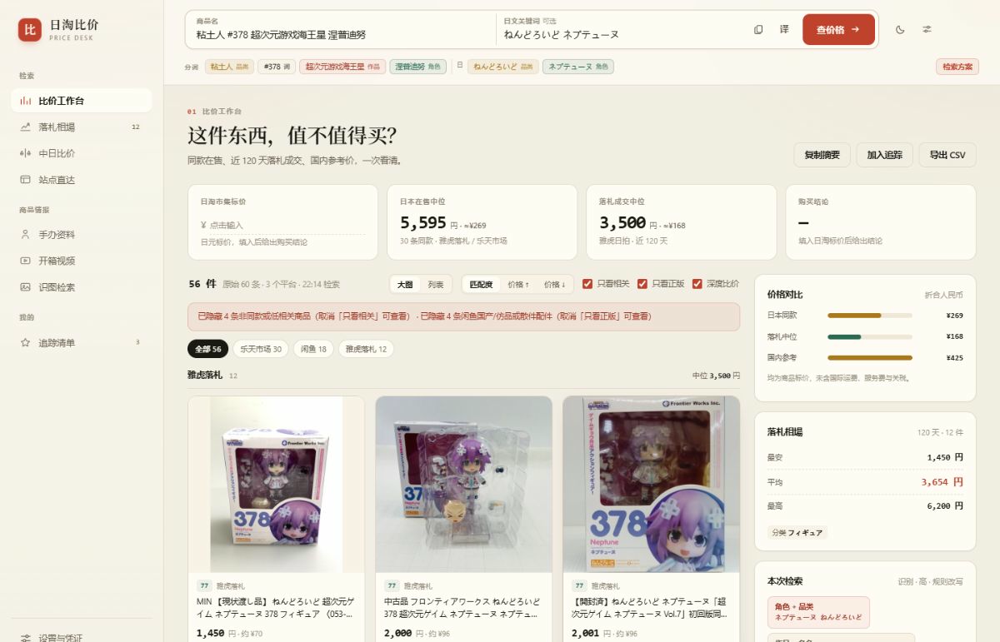
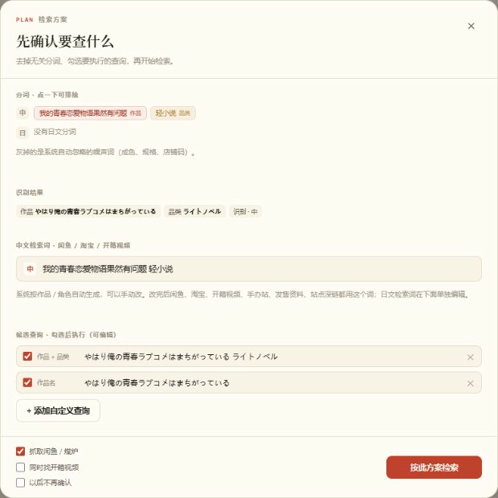
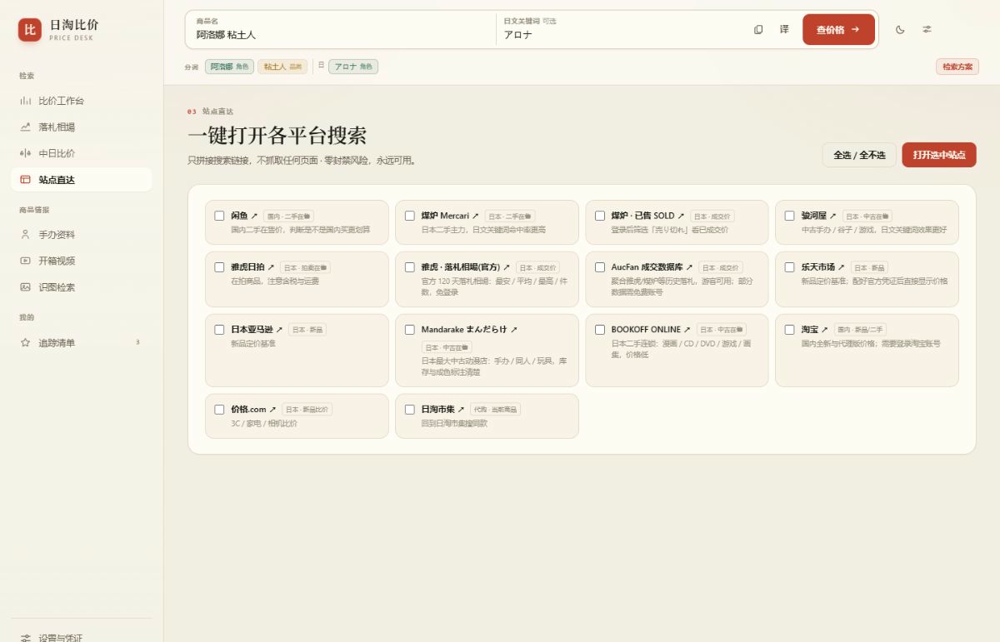
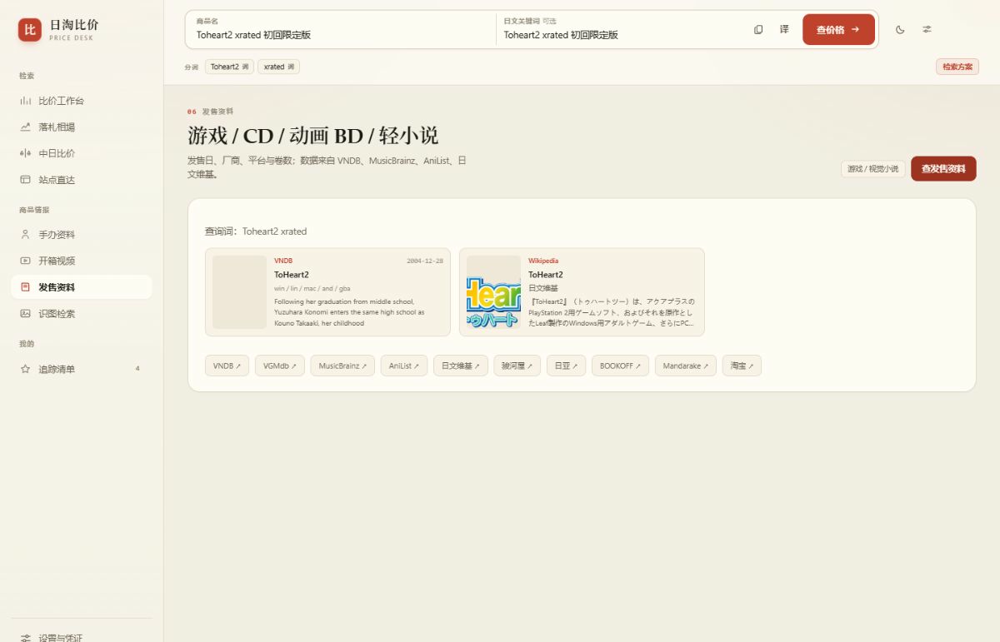
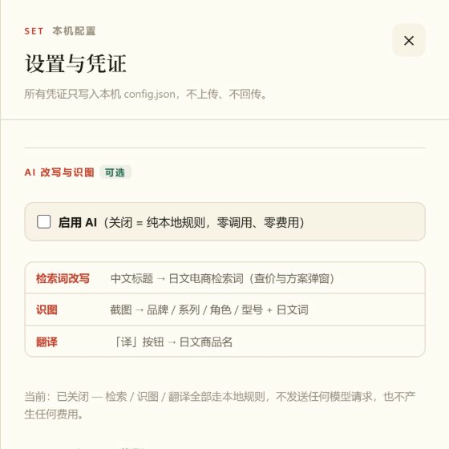

# Ritao Compare · JP Flea-Market Price Checker

[中文说明 → README.md](README.md)

A **fully local** price-comparison tool for Japanese second-hand shopping. Paste a listing title from a JP marketplace app and it checks Goofish (Xianyu), Mercari, Suruga-ya, Yahoo Auctions sold listings and Rakuten for the same item — plus figure release data, unboxing videos, and a one-tap Android overlay.

- **No sign-up, no login, no uploads.** Everything stays in `app/data/` on your machine.
- **Free by default.** AI is off; search runs entirely on built-in dictionaries and rule-based matching, with zero model calls and zero cost.
- **No setup needed.** Just Python. No `pip install`, no database server, no API keys.

> For personal, non-commercial use and learning. Respect each marketplace's Terms of Service, keep traffic low and read-only, and do not use this for bulk scraping.



---

## 1. Quick start (Windows, 3 steps)

### Step 1 — Install Python (once)

Download **Python 3.10+** from <https://www.python.org/downloads/>. During installation, **tick `Add python.exe to PATH`** at the bottom, then click Next through.

> Already installed? Open `cmd` and run `python --version`; any `Python 3.xx.x` works.

### Step 2 — Start the server

Download `RitaoCompare-portable-v1.2.0.zip` from the **Releases** page, unzip it anywhere (avoid non-ASCII characters and spaces in the path), and **double-click `start.bat`**.

A console window appears:

```
Ritao Compare running
  On this PC : http://127.0.0.1:8787
  On phone   : http://192.168.x.x:8787
```

**Keep that window open** — closing it stops the server. Your browser should open automatically; otherwise visit `http://127.0.0.1:8787` manually.

macOS / Linux: `cd` into the unzipped folder and run `bash start.sh`.

### Step 3 — Search

Paste a listing title into the top field → click **检索方案 / Search plan** → review or edit the **Chinese query** and the **Japanese candidates** → click **按此方案检索 / Run search**.

Nothing is fetched automatically. A request only happens when you click the button.

---

## Screenshots

All images below are real captures from a local run (sample items are public listings; machine-specific details such as the LAN address have been removed).

**Search plan** — before anything is fetched you confirm *what* to search: drop noisy tokens, and freely edit both the Chinese query and the Japanese candidates. The edited Chinese term is then used by Goofish, Taobao, unboxing videos, release info and every other Chinese-side search.



| Sold auctions · 120-day price distribution | Unboxing videos · Bilibili / YouTube / niconico |
| :--- | :--- |
|  |  |

| Site shortcuts · open a dozen marketplaces | Release info · games / CD / BD / light novels |
| :--- | :--- |
|  |  |

**Zero-cost switch** — turn off "Enable AI" in Settings and query rewriting, image recognition and translation all fall back to local rules. No model request is sent, and saved credentials are never used.



**On a phone** — the same URL adapts automatically in a mobile browser, or install the overlay APK from Releases for one-tap price checks inside a shopping app.


> Images live in [`docs/screenshots/`](docs/screenshots/). Matching `.jpg` files are also bundled in the portable zip from Releases for offline viewing.

---

## 2. Using it on your phone

### Option A — Browser (nothing to install)

1. Connect phone and PC to the **same Wi-Fi**.
2. Use the "On phone" address printed in the console, e.g. `http://192.168.x.x:8787`.
3. Open it in the phone browser. The layout adapts to small screens.

> If it won't load, Windows Firewall is usually the culprit — allow Python through it.

### Option B — Android overlay app (optional)

Download `RitaoCompare-v1.2.0.apk` from Releases and install it (allow "unknown sources").

1. Open the app and set **PC service address** to `http://<your-PC-LAN-IP>:8787` (replace the default `127.0.0.1`, keep port 8787), then tap **Save**.
2. Grant the **overlay permission** and the **accessibility service** when prompted.
3. In any marketplace app, use **Share → Ritao Compare**, or tap the floating bubble, to open the comparison panel with the item title pre-filled.

> The app is only a remote control that sends the title to your PC. All lookups run on the PC; the phone stores no accounts or data.

---

## 3. Optional settings (everything works without them)

Open **Settings** in the top-right. Config lives in `app/config.json` on your machine — it is **not** in this repository and is **never** returned by the API.

| Setting | What it does | If left empty |
|---|---|---|
| **HTTP proxy** | Reach JP sites through your own proxy, e.g. `http://127.0.0.1:7897` | JP sites may time out; those platforms fall back to plain search links |
| **Rakuten API keys** | Adds live Rakuten prices | Rakuten shows a deep link; everything else still works |
| **Enable AI** | Title rewriting / image recognition / translation | **Off by default** — local rules, zero cost. Only when enabled is anything sent to the endpoint you configured |
| **Confirm plan before search** | Shows the keyword editor before each search | Keep it on: it lets you fix the Chinese query, which matters most for Goofish |
| **Browser scraping (Tier C)** | Reads prices from pages rendered in your own logged-in browser | Off by default; public APIs and deep links only |

### "No LLM" mode

The master switch is at the top of **AI rewrite & vision** in Settings. When off it is a **hard block**: rewriting, vision and translation all use local rules, not a single model request is made, and saved credentials are never used. The results header shows either `local rules` or `AI rewrite` so you can verify.

### Editing the Chinese query in the plan dialog

Chinese marketplaces and video sites dislike long titles. The tool generates a short Chinese query, but **you can edit it by hand** — Goofish, Taobao, unboxing videos, figure sites, release data and site deep links will all use your version. Japanese candidates are edited separately below.

Example: for `我的青春恋爱物语果然有问题 轻小说` the Chinese query keeps the full work title instead of collapsing to just "light novel" and returning unrelated listings.

### About Tier C (browser scraping)

Disabled by default. Enabling it needs `pip install playwright` and Chrome. It only opens public search pages and reads already-rendered text — no clicks, no form submits, no authenticated API calls — with a minimum interval and an hourly cap. Goofish may ask for a one-time QR login (the session is stored in your own `~/.ritao-compare/browser-profile`). Rate limits degrade gracefully instead of hanging the search.

---

## 4. Troubleshooting

**`start.bat` flashes and closes?** Python is missing or wasn't added to PATH. Reinstall with the checkbox ticked, or verify with `python --version` in `cmd`.

**Page won't load / spins forever?** Make sure the console window is still open, use `http://127.0.0.1:8787`, and try Chrome or Edge. On a phone, use the LAN address, not `127.0.0.1`.

**Some platforms only show a "jump" link, no price?** Amazon JP, Mandarake and Taobao have anti-bot measures or require login. The tool intentionally generates a search deep link instead of trying to bypass them.

**Too many unrelated results?** Open the plan dialog, tighten the Chinese and Japanese queries, or click a token chip to exclude it. Cross-category listings, bundles and parts-only listings are filtered out. **An honest "no matching items" is preferred over padding with irrelevant products.**

**Will my account get banned?** Default settings never touch a logged-in session. Tier C is opt-in, read-only, low-frequency, rate-limited and degrades on failure. No automation is truly zero-risk — if that worries you, leave it off.

**Where is my price history?** `app/data/prices.db` (SQLite, created on first run). Deleting it clears history and does not break anything.

---

## 5. Project layout

```
app/           Local Python service (standard library, no required deps)
  server.py        HTTP server and all /api routes
  query_engine.py  Tokenising, candidate queries, exact-match judging, reranking
  dicts.py         Series / character / category dictionaries
  sources.py       Rakuten, Yahoo sold listings, Suruga-ya, Hpoi, deep links
  browser.py       Optional read-only browser scraping
  media.py         Release data (VNDB / MusicBrainz / AniList / Wikipedia)
  videos.py        Unboxing videos (Bilibili / YouTube / niconico)
  llm.py           Optional AI adapter (off by default)
  store.py         Local price-history database
  config.example.json  Config template (real config is app/config.json, untracked)
web/           Workbench front end (plain HTML / CSS / JS, no build step)
android/       Android overlay app source
extension/     Optional browser extension
start.bat      One-click Windows launcher
start.sh       One-click macOS / Linux launcher
```

To build the APK yourself you need Android SDK build-tools and a JDK — see `android/build-manual.sh` (point `JBR` at your JDK). For everyday use, just grab the APK from Releases.

---

## 6. Privacy

- This repository contains **no** API keys, proxy addresses, LAN IPs, accounts, search history or cached images.
- `app/config.json`, `app/data/`, the Chrome profile and the signing keystore are all gitignored; the real files have never been committed.
- `/api/config` returns only `has_*` booleans, never credential values.
- Apart from the Rakuten / AI endpoints you explicitly configure and public marketplace pages, the program sends nothing to third parties.

---

## 7. License

No open-source license has been assigned yet; this is for personal learning and self-use. Before publishing or redistributing, add a suitable LICENSE and make sure you comply with the relevant platform terms.
