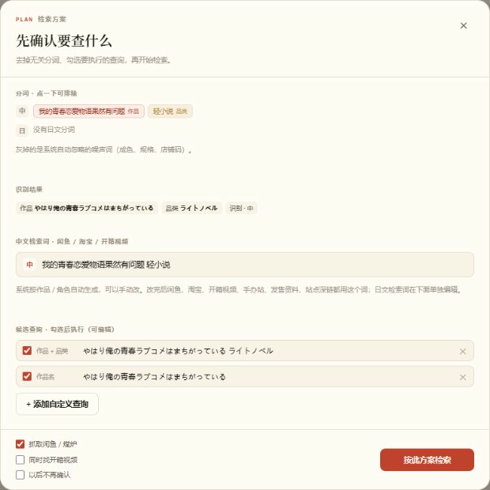
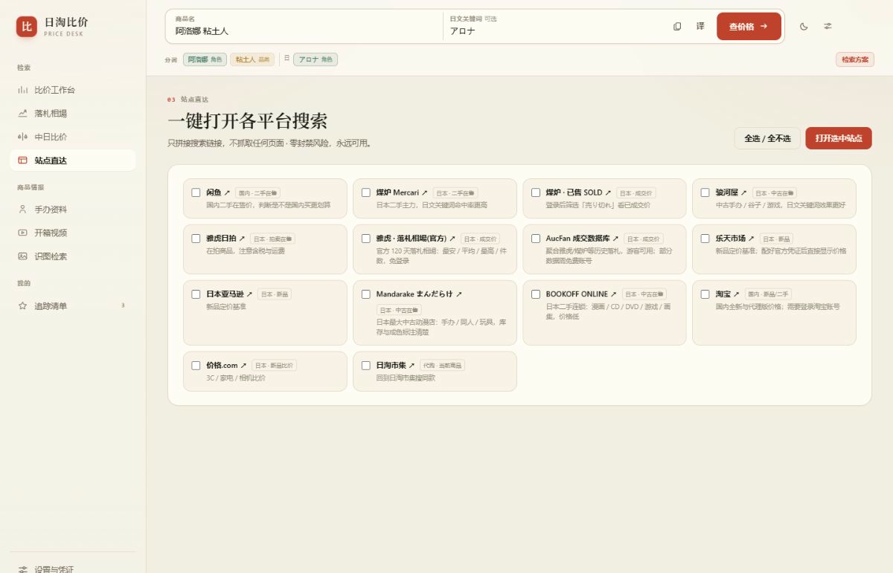
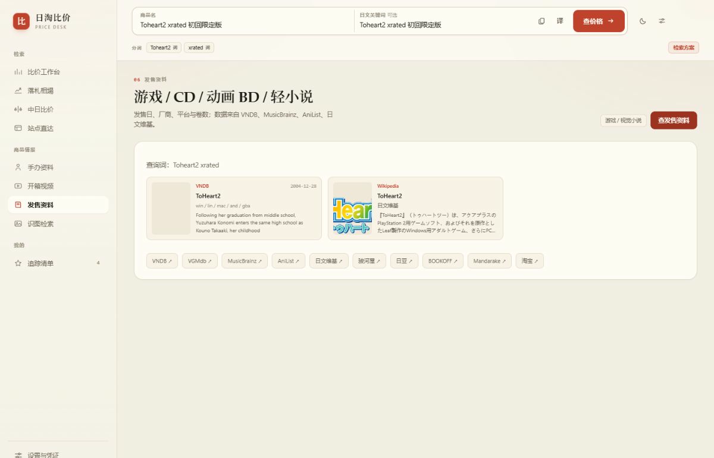
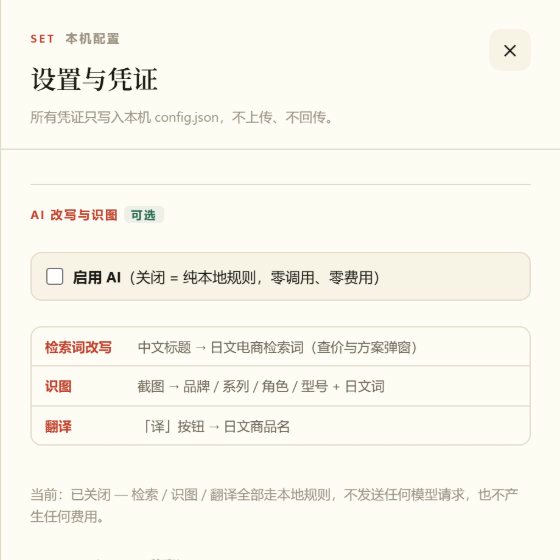
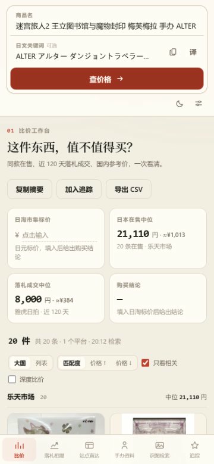

# 日淘比价助手 · Ritao Compare

[English version → README.en.md](README.en.md)

一个**完全跑在你自己电脑上**的日淘比价小工具。在日淘市集 / 煤炉看到一件商品，把标题丢进来，它会帮你同时看：闲鱼、煤炉、骏河屋、雅虎落札相場、楽天上的同款价格，还能查手办发售资料、开箱视频，并在手机 APP 里用悬浮窗一键查价。

- **不注册、不登录、不上传**：所有数据只在你本机的 `app/data/` 里。
- **不用花钱**：AI 功能默认关闭，检索全程走内置词典和规则算法，零 API 调用、零费用。
- **不用配置就能跑**：只需要 Python，不需要 `pip install`，不需要数据库，不需要 API Key。

> 本项目定位为个人自用与学习研究。请遵守各电商平台的服务条款，低频、只读使用，不要用于批量抓取或商业用途。


---

## 一、最快上手（Windows，3 步）

### 第 1 步：装 Python（只用装一次）

去 <https://www.python.org/downloads/> 下载 Python **3.10 或更高版本**，安装时**务必勾选最下面的 `Add python.exe to PATH`**，然后一路 Next。

> 已经装过 Python 可以跳过。验证方法：按 `Win + R` 输入 `cmd` 回车，敲 `python --version`，能看到 `Python 3.xx.x` 就行。

### 第 2 步：启动

从本仓库的 **Release 页面**下载 `RitaoCompare-portable-v1.2.0.zip`，解压到任意文件夹（路径里最好没有中文和空格），然后**双击 `start.bat`**。

会弹出一个黑色窗口，显示：

```
日淘比价助手已启动
  电脑访问： http://127.0.0.1:8787
  手机访问： http://192.168.x.x:8787
```

**这个黑窗口要一直开着**，关掉就等于停止服务。浏览器一般会自动打开工作台；没打开就手动访问 `http://127.0.0.1:8787`。

macOS / Linux：在终端里进入解压目录，执行 `bash start.sh`。

### 第 3 步：查价

在顶部输入框粘贴商品标题 → 点「检索方案」→ 检查（或直接改）**中文检索词**和**日文候选词** → 点「按此方案检索」。

就这么简单。默认**不会自动搜索**，只有你点按钮才会发请求。

---

## 界面一览 · Screenshots

以下都是本机真实运行画面（示例商品为公开在售商品，截图已去除本机局域网地址等环境信息）。

**检索方案** — 点「检索方案」后先确认查什么：分词可以点掉，中文检索词和日文候选词都能手动改，改完会用于闲鱼、淘宝、开箱视频、发售资料等所有检索。



| 落札相場 · 近 120 天成交价分布 | 开箱视频 · B 站 / YouTube / niconico |
| :--- | :--- |
|  |  |

| 站点直达 · 十几个平台一键打开 | 发售资料 · 游戏 / CD / BD / 轻小说 |
| :--- | :--- |
|  |  |

**零费用开关** — 设置里关掉「启用 AI」，检索词改写、识图、翻译全部走本地规则，一个模型请求都不发，凭据留着也不会被使用。



**手机端** — 同一个地址在手机浏览器打开会自动适配；也可以装 Release 里的悬浮窗 APK，在日淘 APP 里一键查价。



> 图片文件在 [`docs/screenshots/`](docs/screenshots/)。同名 `.jpg` 也随 Release 的绿色压缩包一起提供，方便离线查看。

---

## 二、手机也能用（两种方式）

### 方式 A：浏览器打开（不用装任何东西）

1. 手机和电脑连**同一个 Wi-Fi**。
2. 看电脑黑窗口里打印的「手机访问」地址，例如 `http://192.168.x.x:8787`。
3. 手机浏览器输入这个地址即可。界面会自动适配手机屏幕。

> 如果打不开，多半是 Windows 防火墙拦了。允许 Python 通过防火墙，或暂时关闭防火墙试一次。

### 方式 B：安卓悬浮窗 APP（选装）

从 Release 下载 `RitaoCompare-v1.2.0.apk`，传到手机安装（会提示「未知来源」，允许即可）。

1. 打开 APP，在「电脑上的服务地址」里填 `http://电脑局域网IP:8787`（把默认的 `127.0.0.1` 换成电脑 IP，端口 8787 不变），点「保存地址」。
2. 按提示打开「悬浮窗权限」和「无障碍服务」。
3. 之后在日淘市集等 APP 的商品页，点系统**分享** → 选「日淘比价助手」，或点悬浮球，就会带着商品标题打开比价面板。

> APP 只是个「把标题送到你电脑」的遥控器，**真正的查询全在电脑上运行**，手机不存任何账号或数据。

---

## 三、可选设置（不填也完全能用）

打开页面右上角「设置」。所有配置保存在本机 `app/config.json`，这个文件**不会**出现在仓库里，也**不会**通过接口返回给任何设备。

| 设置 | 作用 | 不填会怎样 |
|---|---|---|
| **Clash / HTTP 代理** | 访问日本站点。填你自己的代理地址，例如 `http://127.0.0.1:7897` | 国内网络访问日本站可能超时，部分平台只显示跳转链接 |
| **楽天 API 凭证** | 多一路楽天在售价 | 楽天结果显示为深链，其他平台照常工作 |
| **启用 AI** | 标题改写 / 识图 / 翻译 | **默认关闭**，走内置规则，零消耗。开启后才会把内容发给你自己填的接口 |
| **检索前确认方案** | 每次检索前弹出关键词编辑窗 | 建议保持开启，可手动修正中文词（闲鱼全靠它） |
| **启用浏览器抓取（Tier C）** | 读取你自己已登录浏览器渲染出的闲鱼 / 煤炉价格 | 默认关闭，只用公开接口与深链 |

### 关于「不使用 LLM」

设置 → 「AI 改写与识图」最上面有总开关。**关闭时是硬性拦截**：改写、识图、翻译一律走本地规则，一个模型请求都不会发出，凭据留着也不会被使用。检索结果页顶部会标注「本地规则」还是「AI 改写」，方便确认。

### 关于「检索方案」里的中文词

中文电商（闲鱼 / 淘宝）和开箱视频对长标题很挑。系统会自动生成一条简短的中文检索词，但**你可以手动改**——改完后闲鱼、淘宝、开箱视频、手办站、发售资料、站点深链都会统一用这个词。日文候选词在下面单独编辑，互不影响。

例：输入 `我的青春恋爱物语果然有问题 轻小说`，中文词会保留完整作品名，而不是退化成只剩「轻小说」去搜出一堆无关商品。

### 关于 Tier C（浏览器抓取）

默认**关闭**。开启后需要 `pip install playwright`，并且要有 Chrome。它只做「打开公开搜索页 → 读取已经渲染出来的文字」，不点击、不提交表单、不调用任何需要登录态的接口，还带最小间隔和每小时上限。闲鱼可能要求扫码登录一次（登录态存在你自己的 `~/.ritao-compare/browser-profile`）。平台可能会限流，失败会自动降级，不会卡住整个检索。

---

## 四、常见问题

**Q：双击 `start.bat` 一闪就没了？**
没装 Python，或装的时候没勾 `Add to PATH`。重装一遍并勾选，或在 `cmd` 里 `python --version` 确认。

**Q：页面打不开 / 一直转圈？**
确认黑窗口还开着；确认访问的是 `http://127.0.0.1:8787`；换 Chrome / Edge 试试。手机访问要用局域网地址，不是 `127.0.0.1`。

**Q：为什么有的平台只有「跳转」没有价格？**
日亚、Mandarake、淘宝等站点有反爬或需要登录，工具只生成搜索深链，点过去在浏览器里看。这是有意为之，不做绕过。

**Q：搜出来全是无关商品？**
点「检索方案」，把中文词和日文候选词改精准些，或点掉分词条里的干扰词。工具会主动过滤跨品类 / 打包 / 配件商品；**宁可显示「无相关商品」，也不会拿无关商品凑数**。

**Q：会不会封我的账号？**
默认配置下不会碰任何登录态。Tier C 是选装的、只读的、低频的，并带限流与降级。但没有任何自动化能做到「零风险」，介意就别开。

**Q：历史价格存在哪？**
`app/data/prices.db`（SQLite，首次运行自动创建）。删掉这个文件就等于清空历史，不影响程序运行。

---

## 五、目录结构

```
app/           Python 本地服务（标准库，无强制依赖）
  server.py        HTTP 服务与所有 /api 接口
  query_engine.py  分词、候选词生成、同款判定、排序、正版识别
  dicts.py         作品 / 角色 / 品类词典
  sources.py       楽天、雅虎落札、骏河屋、Hpoi、深链
  browser.py       选装的浏览器只读抓取
  media.py         发售资料（VNDB / MusicBrainz / AniList / 维基）
  videos.py        开箱视频（B站 / YouTube / niconico）
  llm.py           可选的 AI 接口封装（默认关闭）
  store.py         本机历史价格库
  config.example.json  配置模板（真实配置是 app/config.json，不入库）
web/           工作台前端（原生 HTML / CSS / JS，无构建步骤）
android/       安卓悬浮窗 APP 源码
extension/     浏览器扩展（选装）
start.bat      Windows 一键启动
start.sh       macOS / Linux 一键启动
```

想自己编译 APK？需要 Android SDK build-tools 与 JDK，见 `android/build-manual.sh`（用 `JBR` 环境变量指定 JDK 路径）。日常使用直接下 Release 里的 APK 就好。

---

## 六、隐私说明

- 仓库里**不含**任何 API Key、代理地址、局域网 IP、账号、检索历史或图片缓存。
- `app/config.json`、`app/data/`、Chrome 登录 profile、签名密钥都在 `.gitignore` 里，且真实文件从未提交过。
- `/api/config` 只返回「是否已配置」的布尔值，不返回密钥内容。
- 除了你主动填写的楽天 / AI 接口和各电商公开页面，程序不向任何第三方发送数据。

---

## 七、许可

本项目目前**未指定开源许可证**，仅用于个人学习与自用。若要公开分发或二次开发，请先自行补充合适的 LICENSE，并确认遵守相关平台条款。
